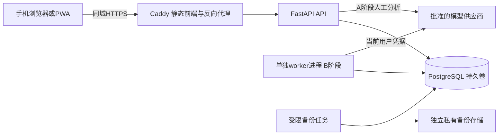

# 游戏人生：下一阶段开发计划

日期：2026-10-09  
代码基线：`d8e7b95cf1edb1b9f724c1c97e59fed258cfcd3b`（v1.11）  
状态：顾问设计交付，尚未实施；文中的推荐默认值不是用户已确认的产品细节。  
配套文件：[上云准备与操作指南](CLOUD_PREPARATION_GUIDE.md)。仓库根目录：`C:\Users\19687\Desktop\游戏人生\work_place\my-life-rpg`。

## 0. 本轮目标、依据与授权

先交付这样的成果：项目所有者的电脑关机后，本人和受邀朋友仍能用手机登录、保存和回看自己的文字；没有模型 Key、AI 失败或没有明确目标，都不妨碍记录。随后交付可恢复的分析、睡前回顾，最后逐步区分成长积累和当前状态。

阅读依据为 [交接任务书](ADVISOR_HANDOFF_2026-10-09.md)、[产品复盘](PRODUCT_REVIEW_2026-10-09.md)、[v1.11 交付记录](review/V1_11_DELIVERY_2026-10-08.md)、`DEV_PLAN_v1.11.md`、`DECISIONS.md`、`PRD.md`、`WRITER_PROMPT.md`，以及下述代码。冲突时以此次用户目标为先，现有代码核实事实，最新决策约束历史结算，早期文档只提供背景。

本轮实际只新增这两份文档。不安装技能，不修改应用，不运行迁移，不购买、部署或上传真实库，不提交或推送。本文件中的实施指令供后续获得实施授权的 Writer 使用。

验证记录必须区分：v1.11 文档记载的 34 项通过属于此前实施验收；本会话前次审查另运行了 14 项内存服务回归和前端逻辑脚本，并复现三条缺陷，HTTP 客户端测试受环境阻塞。编写本文件期间只查阅源码和官方资料，没有重新运行项目测试，也没有读取或更改真实库。

## 1. 已确认、推荐、暂缓与执行前选择

| 分类 | 内容与落地边界 |
|---|---|
| 已确认需求 | 手机随时使用、朋友简单试用、白天碎片记录/晚上回顾、可延期补充与确认、云端保存/本地导出、每用户 BYOK 与不同供应商、成长经验与当前状态分开、保留规则和有依据的酌情支持、节约资金 |
| 推荐默认方案 | 邀请制文字 Web；Vue/FastAPI 模块化单体；同机 PostgreSQL；数据库任务表与同机 worker；四入口手机导航；先 5–10 人试用至少两周。这些是可评审建议，不是采购或上线承诺 |
| 暂缓 | 站内录音、原声、图片识别、视频、媒体上传体系、复杂助手/桌宠、支付套餐、排行榜、公开社交。手机输入法语音转文字可直接使用 |
| 继续保留 | 目标、挑战、金币、商店、成就、豁免、锚点和历史流水；移动导航重排不删除这些功能和数据 |
| 旧约束调整 | M1–M3 不做登录、v1.11 不上云属于旧版本范围；新阶段可以实现。已入账冻结、审计保留等账目规则继续有效 |

技术默认选择见下表。替代方案有明确触发条件，不逐项重复访谈。

| 事项 | 推荐与理由 | 替代及代价 |
|---|---|---|
| 登录 | 单次邀请链接 + 用户名/密码；服务端会话 Cookie；不依赖短信和邮件，适合少量朋友 | 邮件魔法链接需邮件通道、送达和恢复运维；公众阶段再评估 |
| 找回 | 注册时显示一次恢复码；数据库仅存摘要；使用后换码并撤销会话 | 无恢复码由所有者离线核验后发单次重置令牌，不能仅凭用户名重置，也不能查看旧密码 |
| 数据库 | PostgreSQL，同机降低费用；开发/验收即使用目标数据库 | SQLite 仅作为限量过渡，限制与触发条件见第 4 节 |
| 后台任务 | PostgreSQL 持久化任务表，一个 worker，先不引入 Redis/Celery | A 阶段先同步人工触发，必须如实说明关闭请求后不保证继续；B 阶段再替换 |
| PWA | 首批图标、manifest、安装说明；可联网使用，离线不承诺云端已保存 | 离线正文队列延后，避免首批扩大跨账号缓存与冲突处理范围 |
| 模型 | 每用户显式配置；配置可用性回退仅在该用户已启用的组内进行 | 平台共享额度默认关闭，另获预算授权后才设计限额，不读取个人 `.env` 给朋友兜底 |

仅以下三类事项需要执行前由所有者作具体选择，不妨碍现在写代码：①采购地域、套餐、域名与续费订单；②本人真实库是否迁入指定本人账号及历史异常处理方案；③后续公众开放或平台代付额度。阶段 C 的新规则先作为单独版本评审，通过后再启用，不能借本计划自动重算历史。

## 2. 当前代码基线与上线缺口

| 位置 | 已核实事实 | 开发含义 |
|---|---|---|
| `app/services/user_service.py:13`、各 router | 获取固定 `default`；用户表仅用户名等字段，没有真实登录 | 全量改为服务端认证上下文，不能只给首页加登录框 |
| `app/models/__init__.py` | 17 张表；大部分有 user_id；`anchors` 无 user_id；属性、设置、成就已有用户内唯一约束 | 业务归属需逐表/跨表检查；锚点校准不能继续改全局行 |
| `app/routers/events.py:55` | 非纯享日记在 INSERT 前调用 AI 提取；失败返回 503 | 原文持久化必须先于任何模型调用，后端也要拆分 |
| `app/services/llm_config.py:77` | 用户 primary/aux 可互相按配置缺失回退，最后读全局 `.env` | 云模式禁止隐式使用所有者密钥；保留本地模式需显式运行配置 |
| `app/routers/settings.py:99` | Key 直接写入 Setting.value，GET 掩码；端点可填写 | 云端新增凭据加密与供应商白名单，不能把掩码当加密 |
| `app/services/llm_service.py:57`、`:106` | 同步请求；应用未显式设置请求超时；缓存按明文 Key/URL；异常拼入响应；JSON 失败会重试 | 核实并限制 SDK 内部重试，加任务层总重试预算；异常脱敏；缓存按用户配置版本有界管理 |
| `app/database.py:39`、`app/main.py:66` | 启动补列/标量回填、默认用户初始化；CORS 为 `*` | 生产改版本迁移，去掉隐式建档/默认用户；同域部署与认证一起验收 |
| `app/services/backup_service.py:20` | 仅 SQLite 在线备份；非 SQLite 返回 None；备份失败不阻断启动 | PostgreSQL 需要新备份/恢复机制；现有接口不能继续假报成功 |
| `app/services/transactions.py`、结算服务 | 用 profile 无变化 UPDATE 加锁；状态抢占与部分服务内部 commit | PostgreSQL 重验锁序、刷新、唯一约束与原子提交；任务写回不能调用会提前提交的旧函数而假称同事务 |
| `app/services/challenge_service.py:453` | 挑战完成先取得写锁、创建事件再等待模型 | 必须拆为读快照/释放事务/调用模型/短事务校验写回 |
| `frontend/src/App.vue:17`、`:107` | 九个导航；建档提示不阻止其他页面挂载 | 收敛导航，区分可记录与游戏基线，不能强制长问卷 |
| `EventForm.vue`、`TodayCheckin.vue`、`useDateGroups.js` | 有草稿和重试 ID，但多为组件内状态；缓存键没有账号命名空间 | 弱网幂等靠服务端；跨账号隔离及切页恢复需新增 |
| `frontend/vite.config.js`、`start-phone.bat` | 开发代理/局域网监听 | 不作为生产或电脑关机后可用的方案 |
| `requirements.txt` | 目前没有 Alembic、PostgreSQL 驱动、密码哈希、凭据加密依赖；版本为最低约束 | 加依赖、锁定验收版本和镜像摘要，不能只改连接串 |
| `tests/` | 有 v1.11 回归；部分测试会写证据文件、创建临时磁盘库；冒烟脚本执行真实启动迁移 | 新测试显式隔离库、禁止默认连接真实库；旧“只读冒烟”名称不等于无写入 |

本会话已发现、仍在当前 HEAD 的遗漏，应作为 A00 前置修复，不写成“已解决”：

| 编号 | 复现与推荐修复 | 验收 |
|---|---|---|
| R1/P1 | 接受挑战→完成自述→删除事件，挑战仍 accepted，结算/放弃失败，到期后列表异常。推荐拒绝删除仍关联 accepted 挑战的事件，引导挑战页处理；终态删除继续保留审计 | 待结算删除返回 409 且无变动；可继续正常结算/放弃；过期列表不被该操作破坏 |
| R2/P1 | 未建档先 GET coins 发 80，后建档快照 123 而余额仍 80。推荐取消余额 GET 发币；建档完成与首次金额同事务，历史 40 不补差 | 先浏览所有页面再建档，余额等于本次初始金额且仅一条启动资金流水 |
| R3/P1 | 逻辑删除后追授接口仍接受旧建议，实测新增 50 币。推荐追授写入前校验关联事件、判定状态与归属，并与删除使用一致锁序 | 删除和追授竞争时有确定次序；删除先完成则不能新发奖；已发金币仍保留 |
| R4/P2 | 判定中心将所有 challenge 判定落入“已入账”分支 | pending/adjusted 显示“待结算，前往挑战页”；仅 confirmed 显示已入账 |

交付记录还报告 `ai_judgments.id=35` 引用缺失的 `event_id=34`，并称备份已有同一异常。此处是引用既有记录，未重新核验真实库。它与更早审计“无悬空”的记载不一致；迁移必须在冻结副本上再次核对，作为独立异常阻断处理，不能自动删行、补造事件或放弃约束。

## 3. 分批成果、依赖与工作量

工作量采用相对尺度：S 为局部改造，M 为跨前后端模块，L 为跨数据/业务/部署的系统改造。不是人日或日历承诺，阶段 A 工作量最大；不得按“加登录 + 换数据库”低估。

| 交付批次 | 条目 | 依赖 | 可单独验收成果 | 相对量 |
|---|---|---|---|---|
| A0 地基 | A00、A01、A02 的基础 | 无采购依赖 | 审查遗漏修复、版本迁移骨架、隔离测试库 | L |
| A1 手机记录 | A03、A04、A05 | A0；权限基础 | 双用户文字保存/回看/导出；不依赖 AI 或问卷 | L |
| A2 模型与旧玩法 | A06、A07、A08 | A1、PostgreSQL 验收 | 用户自带 Key、显式人工分析、原结算、最小手机布局 | L |
| A3 内测发布 | A09 | A1/A2 全部硬门槛通过；采购另确认 | 同域 HTTPS、关机可用、独立备份可恢复 | M–L |
| B1 后台分析 | B01、B02 | A 稳定；任务协议先定 | 重启可恢复、延期追问、统一待处理 | L |
| B2 睡前回顾 | B03 | B1；按日接口 | 复用当天记录、只确认未处理事实、不重复奖励 | M |
| C 成长过渡 | C01、C02 | A/B 的数据版本和审计；规则单独评审 | 新积累/状态与旧 13 维并存，完整视觉统一 | L |

阶段 A 不等待 C 或任何媒体能力。A2 可先交付同步人工分析：保存先返回，用户再点击分析；请求中断后通过原事件查询/重试，不承诺后台继续。A3 发布材料必须写清这个边界。B 上线后替换为持久任务，业务建议和确认入口保持一致。

个人和未来公众体验保持同一代码库，以部署配置、功能开关和规则版本区分，不维护另一套分叉结算逻辑。暂缓项只保留路线触发条件：站内语音/图片需真实内测反复证明输入法文字不足，且有授权/容量/隐私/成本方案；视频需明确不可被文字替代的场景和独立预算；助手/桌宠需证明能减少实际步骤而非增加干扰；收费/公开社交需稳定留存、支持能力、成本核算与公开服务要求评估。满足触发条件后另立项，不提前建媒体表、采购套餐或支付体系。

## 4. 运行拓扑、职责与数据库取舍



服务器起步建议 2核4GB Linux，应用、数据库同机；前端在构建环境生成，云端运行静态产物，避免小内存机器现场构建。初期一个 API 进程、一个分析 worker、分析全局并发 1；测量后扩容。Compose 使用私有网络，数据库/API/worker 不发布公网端口，只有入口 80/443；SSH 限所有者管理来源。数据库卷、Caddy 证书卷与加密密钥独立于应用镜像。

保留现有 services；新增 `auth`、`credentials`、`analysis_jobs`、`review`、`time_service`、`owned_repository` 等模块。业务服务接收显式 user/user_id，不自行获取 default；入口负责事务；模型适配器只处理已授权的调用；worker 只产生建议，不自动确认属性/金币。

推荐 PostgreSQL 18 当前稳定线的经测试补丁版本与固定镜像摘要，驱动采用 psycopg 3；最终锁定版本由 A01 兼容测试交付，不能使用 `latest`。Alembic 需要迁移目录、版本链、环境配置、升级测试和明确失败处理，不是仅加依赖。参考 [Alembic 官方教程](https://alembic.sqlalchemy.org/en/latest/tutorial.html)。

若临时保留 SQLite：只能单机本地持久盘、一个 API 写入进程、一个受控 worker，写事务串行且短，不用网络共享盘、不横向多实例、不让 LLM 持写锁；设置并测量忙等待/重试，使用 SQLite backup API。只有在双用户隔离及备份恢复门槛全通过后才能用于受限内测，不因此宣称已兼容 PostgreSQL。建议出现锁错误影响真实记录、需要多实例/并发 worker、备份维护难以保障，或公开扩展前即迁移；这些是评估触发条件，不以“超过十个用户”拍脑袋保证容量。

## 5. 数据归属、增量模型与历史兼容

### 5.1 17 张既有表的处理

| 表 | 新阶段归属/迁移要求 |
|---|---|
| users | 独立账号；旧 default 不自动成为任何访客；新增认证信息与状态，不暴露用户名全集 |
| user_profiles | 一账号一档案；保留原始画像、基线、已建档标记、金币、记忆；新账号不复制本人画像 |
| attributes | 用户内名称唯一；父维须同用户；保留全部 13 维与子维当前值/提议 |
| attribute_history | 用户、属性、事件、判定引用必须同属；保留空引用允许的历史类型；不重算 delta/value_after |
| checkin_items | 用户内项目，goal_id 只能引用本人目标；停用语义保留 |
| events | 原文、来源、实际发生时间、逻辑删除、挑战来源全部保留；添加版本/客户端幂等字段 |
| ai_judgments | 用户/事件归属一致；旧 id、状态、建议、实际值保留；新增规则/提示词/模型/输入版本来源 |
| judgment_logs | 对应判定必须同用户且非空；追加审计，不清空旧日志 |
| goals | 用户内目标；终态抢占、点数边界继续生效 |
| anchors | 内置规则模板可共享只读；用户校准改新增覆盖表，不能直接改其他用户的基准 |
| settings | 保留公开白名单；模型凭据移入加密存储；内部设置不得通过通用入口任意修改 |
| coin_ledger | 用户内完整追加流水；`grant` 唯一金币写入口；迁移不发币、不补历史差额 |
| challenges | 用户内挑战及其事件/判定同属；接受押金、结算和终态保持原子性 |
| shop_items | 每用户独立物品及价格；初始化可复制模板，不共享可写价格行 |
| redemptions | 用户内兑换，物品和金币引用同属；已兑换事实原样保存 |
| achievements | 用户内 code 唯一；保留已奖励记录；删除后不再新追授 |
| exemptions | 用户内券与时段；保留既有保护、历史匹配和扣款，不借时区迁移改写旧规则 |

共享 Anchor 的历史校准值推荐复制为“本人账号的 anchor_overrides”，新朋友使用未校准的内置模板；原始 anchors 原样留在 SQLite 副本。此复制与归属需写入迁移报告，不让本人校准变成所有人的默认规则。

### 5.2 建议增量结构

下面为设计契约，不是已存在的表。迁移全部显式版本化；新列有兼容默认或可空，历史填充只能增加来源标记，不改变账目。

| 结构 | 关键字段/约束 | 引入阶段 |
|---|---|---|
| users 增量 | password_hash、status、timezone=`Asia/Shanghai`、credentials_version；role 仅区分 owner/user，不授予所有者读取朋友正文的产品接口 | A |
| auth_sessions | user_id、token_hash、csrf_secret、created/expires/last_seen/revoked；令牌摘要唯一 | A |
| invitations / recovery_tokens | 随机令牌摘要、用途、失效时间、单次消费、邀请创建者/目标账号；不存原码 | A |
| llm_credentials | user_id、group、provider_id、model、encrypted_key、key_id、config_version、enabled；唯一(user_id,group) | A |
| anchor_overrides | user_id、anchor_id、calibrated_value、version；唯一(user_id,anchor_id) | A |
| events 增量 | content_version 默认 1、client_request_id 可空、analysis_intent、timezone_at_capture；唯一(user_id,client_request_id)；旧记录标 legacy，原文不覆写 | A |
| event_derivations | event_id、user_id、event_version、kind、payload、prompt/model/config_version、created_at；AI 标题/摘要/提取与原文分离 | A |
| request_receipts | user_id、operation、request_key、payload_hash、resource_id、response_snapshot；唯一(user_id,operation,request_key)，与业务同事务 | A |
| analysis_jobs | user_id、event_id、event_version、judgment_version、operation、request_key、state、attempts、lease_token、lease_until、next_retry_at、safe_error_code、config_version、timestamps | B |
| daily_reviews / review_links | user_id、local_date、timezone、note、completion；按日唯一；关联既有 event_id/版本，同用户；不自动造奖励事件 | B |
| growth_entries | user_id、event_id、judgment_id、rule_version、source_effect_key、delta、reversal_of、created_at；唯一来源键，冲正关联原行 | C |
| state_observations / context_notes | 用户自述/可观察指标，来源、观察时间、有效期、撤回/纠正；与旧分值不同义 | C |

多用户查询主索引建议 `(user_id, created_at, id)`；事件另加 `(user_id, occurred_at, id)`；待办 `(user_id,state,updated_at)`；任务队列 `(state,next_retry_at,lease_until)`。保留现有用户内唯一约束，补充跨引用同属验证；对高风险结算引用可增加 `(user_id,id)` 复合唯一和复合外键，先检查历史异常再创建，不能关闭 FK 混过。

SQLite 的 Integer 实际可存 64 位，但 PostgreSQL 普通 integer 是 32 位。金币余额、流水 delta/balance_after、挑战 reward/deposit、商店 coin_price、兑换 coin_spent、成就 coin_reward、豁免费用及额外金币字段，均逐列确认并采用 BigInteger；涉及外键的主键类型协调。SQL 运算也不能先在窄类型溢出；奖励限制只保留可存储边界，不新增游戏经济上限。参考 [PostgreSQL 数值类型](https://www.postgresql.org/docs/current/datatype-numeric.html)。

旧属性 Float 与实际流水在本轮不转换成另一种积分体系；副本对账按既有两位实际值及容差验证，不用重新累计/夹取覆盖真实值。结构化 JSON 明确对象/列表/字符串三种旧形状，尤其 `long_term_memory` 是 JSON 字符串，`initial_attributes_snapshot` 是嵌套对象，不能统一平铺。

### 5.3 新账号与建档

注册只创建空用户/画像及标准维度占位，金币 0；占位 13 维不代表完成建档。未建档可保存、看手账和导出，无 Key 也可用。用户主动开启旧游戏结算时，推荐提供两个入口：保留问卷，或“用未评估基线开始”。后者是新增建议：13 维各 50、明确标注为游戏起点而非能力测量、启动资金 80，同事务设置完成标记并保存 `baseline_kind=neutral_opt_in`。问卷仍由 AI 在原规则区间给初始金额。

简易基线需作为 A04 的产品方案评审项，不假装已有。启用后不能再次用问卷覆盖面板，只能走现有有边界的补充；已建档用户不出现重建入口。没有选择任一基线前可以分析并保存建议，确认旧属性/金币结算时提示选择基线，不能暗中写属性流水导致以后问卷永久不可完成。跨设备并发建档最多一次。所有新路径不改变老用户 40 币启动资金。

### 5.4 时间与日期

新系统持久时间为 aware UTC，API ISO 8601 含偏移；用户时区存 IANA 名称，默认 Asia/Shanghai。区分 occurred_at（发生）、created_at（保存）、analysis_started/completed_at（处理）、confirmed_at（入账）；日记“今天”、回顾日期、挑战周期和连续天数经同一 time_service 计算，不用服务器 `datetime.now()` 各算各的。

旧库无时区时间按已知本人使用场景 Asia/Shanghai 解释后换算，保留源值与迁移说明；若副本中出现不明时区，停止猜测并列异常。新 API 接受偏移时间或明确 local_datetime+timezone，拒绝含糊输入；切换时区只影响以后默认分组，不改既有挑战 period_key/已购券窗口/已结算事实。券现行 23:59 与端点包含关系保留，另版本讨论，不在本轮悄悄改半开区间。

### 5.5 阶段 C 的候选规则与情境期限

本小节是供单独评审的首版推荐，不是生效规则；A/B不依赖它上线。成长点是游戏化记录，不承诺为科学验证的精确能力或幸福测量。

| 量 | 候选规则 | 更正/未知 |
|---|---|---|
| 成长积累 | 仅对cutover后的已确认行动，按证据给总计1–3点：明确完成的小行动1点、有明确过程/投入2点、可核验阶段里程碑3点；每事件总额不超过3，可分配到至多两个维度；只生成建议，确认才写账 | 同事实通过回顾/挑战/补充仍引用原事件，不重复加点；误授按原条目追加冲正、禁止重复冲正。生病、没记录、没行动不扣成长积累；旧属性扣分仍按旧规则 |
| 能力表现 | 原13维与子维继续显示旧规则及0–100边界，不映射成上述经验值 | 初始中性占位标“未评估”；长期未有证据标更新时间，不能说精准测量 |
| 当前状态 | 可选自评精力/压力/心情各1–5，显示个人尺度含义和观察时间，不合成为总幸福分；默认当天有效 | 无自评为未知，跨日为待更新，保留历史点；任务完成不能自动提高心情；用户可更正并保留版本 |
| 经济 | 金币/保证金/兑换单独显示 | 不因状态输入自动调币价、退押金或改已接受挑战合同 |

处境推荐由用户主动填写或明确确认AI建议；可选当天、3天、7天、30天，默认7天、单次最长30天，到期退出活动上下文但保留本人可查看的历史；长期处境需主动续期，不永久带入每次分析。可随时纠正/撤回，标记来源、适用范围、起止时间、确认人和版本；过期后不自动续期。健康等私密处境只在相关分析中传给用户所选模型，不进公共日志，导出由本人选择。

酌情支持的候选上限：仅对**新、未确认、允许AI酌情的负向属性建议**，在说明直接相关的用户确认情境后，建议最多减少原扣点绝对值的50%（例如-4至多改为-2），不得翻为正奖励；仍遵守每最终属性绝对变化≤5。原建议、依据、调整前后值并列，用户选择后才确认。固定系统规则、挑战保证金、豁免收费和已确认旧账不在此范围；若要改变它们须另定规则。证据不足保持原建议并允许延期补充，不根据未记录自动判失败。此上限和1–3点尺度须通过具体样例评审与影子试算再生效。

## 6. 认证、凭据、请求与结算边界

### 6.1 全量权限

统一 `get_current_user`，请求体不接受任意 user_id。所有按 ID 入口先查询 `(id,current_user.id)`，外来 ID 统一 404；嵌套的 item/goal/attribute/parent/judgment/challenge/shop/redemption/job 也校验同属。批量接口逐项核验后事务全成或全拒，不能漏一个 ID 仍执行其他扣账。统计、热力图、搜索、报告上下文、记忆、任务查询、导出和缓存同样按用户限制。

账号会话使用高熵随机令牌、数据库摘要、`__Host-` Cookie（Secure/HttpOnly/Path=/，不设 Domain，推荐 SameSite=Lax 以便邀请链接），敏感请求验证 CSRF token 与 Origin；登录轮换会话，登出立即撤销，推荐空闲 7 天/绝对 30 天后重登。密码用 Argon2id，参数以部署机器测试；登录/邀请/找回加速率限制与统一错误，不暴露账号存在性。这些默认值可配置，不是既有能力。参考 [OWASP 会话管理](https://cheatsheetseries.owasp.org/cheatsheets/Session_Management_Cheat_Sheet.html)、[CSRF](https://cheatsheetseries.owasp.org/cheatsheets/Cross-Site_Request_Forgery_Prevention_Cheat_Sheet.html)、[密码存储](https://cheatsheetseries.owasp.org/cheatsheets/Password_Storage_Cheat_Sheet.html)。

全库备份是运维权限，现有 `/backup`、`/backup/list` 改为 owner 专用或移出业务 HTTP；普通用户只导出本人数据。系统管理员基础设施权限不等于可以通过产品接口查看朋友日记；明确告知服务器运营方存在技术接触能力，备份权限最小化。

当前余额、成就、挑战等 GET 有惰性写入，报告 GET 会消耗模型费用。云端将写入迁到受 CSRF 保护的 POST 或后台任务：打开成就墙时前端 POST 检查，再 GET 展示，保持“打开时追溯”的产品时机；启动资金仅在建档事务发放；挑战到期通过任务或显式同步，GET 不扣款；报告通过 POST 创建。禁止仅靠 SameSite 保护这些 GET。

### 6.2 BYOK 与出站访问

用户配置仍分 primary/aux；无组可用返回 `MODEL_NOT_CONFIGURED`，文字保存不受影响。只能在本人启用配置之间按既有可用性规则选择；网络错误、余额不足不自动换供应商消费。每次显示将使用的供应商/模型与费用归本人；测试 Key 需用户主动点击，使用虚构短文本，提示可能产生少量费用。

推荐新增加密凭据表，使用维护中的 cryptography Fernet 等认证加密；每条带 key_id，主密钥由云端只读 secret 文件提供，不与 DB/普通备份放一起；钥匙另有加密离线副本。GET 仅返回 configured、末几位/掩码、模型、启用状态，空输入保持、显式按钮删除；不回传密文。轮换时保留旧解密钥匙直到旧备份过期，旧凭据从 Setting 移除前先在副本验证；历史 SQLite 原副本含明文 Key，须加密保管，不进入 Git 或朋友导出。参考 [Fernet 与轮换](https://cryptography.io/en/latest/fernet/)。

首批供应商采用管理员批准的 HTTPS 端点预设；用户选择供应商和模型，不能任意填写公网/内网 URL。自定义端点须管理员逐个审核协议、精确主机/端口/路径和 DNS/IP；连接阶段阻止 IPv4/IPv6 私网、环回、链路本地、云元数据和重绑定，不跟随跨目的地重定向，不继承不受控代理环境。所有 Key 测试、模型列表、重定价和 worker 都走同一出站策略，不只保护 judge。参考 [OWASP SSRF 防护](https://cheatsheetseries.owasp.org/cheatsheets/Server_Side_Request_Forgery_Prevention_Cheat_Sheet.html)。

客户端缓存以 `(user_id,config_id,config_version)` 管理，设上限/过期/关闭连接，Key 只在调用时短暂解密。错误统一代码与 request_id，不把供应商异常原文、URL 查询参数、正文、Key、Cookie 写日志/前端/追踪。每用户并发建议 1、全局分析并发 1、人工分析预算建议每日 30 次真实调用起步并可调整；保存限流与 AI 限额分开，预算耗尽仍可保存。用量记调用次数、可用 token 和耗时，不用它保证供应商账单上限。

### 6.3 幂等、版本和原子效果

保存由客户端为一次用户意图生成 UUID，重发沿用；服务端唯一(user,operation,key)，比较 payload_hash，相同返回同一资源，不同载荷同键返回 409。文本相同但真实发生两次允许新 UUID；不能用“正文一致”全局去重。保存提交与 request_receipt 同事务；客户端超时先按该键查结果再重发，不能立刻生成新键。

判定修改保留同一现行 judgment_id，追加审计；未入账编辑增加 content_version，使旧分析失效。确认必须携带期望事件版本与判定版本，在短事务内验证归属、状态、置信度和实际落点聚合，再写属性流水/金币/挑战终态/幂等回执，一次提交。固定锁序建议 profile→关联 challenge→event→judgment→按 ID 排序的属性；编辑、删除、追授、到期与 worker 写回统一遵守，不交叉获取造成死锁。异常整事务回滚，有限重试不能再次发放奖励。

历史语义继续保持：confirmed 正文与判定冻结；逻辑删除按真实流水反向并夹取，审计和原判定保留；金币不随删除撤销；一事件一现行判定；13 维 0–100，每次最终属性绝对变化≤5；置信度低于 0.8 禁确认，不能由前端绕过；押金仍由奖励比例派生，COIN_TABLE 仍只是解析兜底。删除已确认记录后重新记录同一事实是否再次给币属于原经济规则问题，本轮不借“去重”改变历史规则；新的回顾必须显式复用原事件。

后台任务采用至少一次执行、业务效果幂等，不承诺供应商只计费一次。模型已经响应但本地断电的窗口可能重复请求；UI 告知可能重复费用，设置小的总尝试预算。模型调用不在持锁事务内，输出严格有限数值/结构校验沿用并扩展。

## 7. 保存、分析、回顾状态与 API 契约

以下未存在的接口均是待实现契约，统一 `/api`；已有接口可保留兼容外观，但实现遵守归属、CSRF、幂等和事务要求。最终 OpenAPI 与部署手册必须同步，不能把这张表当当前可调用清单。

### 7.1 状态分开表达

| 轴 | 状态 | 用户可见语义 |
|---|---|---|
| 本机草稿 | editing / local_draft / sending / uncertain | 尚未云端保存；断网不显示“已保存” |
| 云端记录 | saved / deleted | 已保存原文或按既有规则撤销；与 AI 成功无关 |
| 分析意图 | now / later / never | 立即人工触发、稍后进待处理、不分析；later 不自动调用模型 |
| 分析任务（B） | queued / running / needs_input / ready / failed / cancelled / superseded | 排队、处理中、待补充、待确认、失败、取消、输入已变化 |
| 既有判定 | pending / adjusted / confirmed / invalidated / deleted | 业务状态仍由旧结算服务管理，不用任务状态代替入账状态 |

保存成功即返回 event_id/version；随后分析失败仍显示“记录已保存，分析失败”。“待补充”保存问题与回答版本，允许离开；confirmed 后只读，不提供复核/编辑按钮。取消 worker 是使租约失效、阻止回写，不保证已发出的模型请求停止计费。

### 7.2 接口

| 接口 | 请求/响应要点 | 权限与失败 |
|---|---|---|
| POST `/auth/register` | invite_token、username、password；创建空账号，返回一次 recovery_code | 邀请单次原子消费；限流；无邀请不可注册 |
| POST `/auth/login`；POST `/auth/logout`；GET `/auth/me` | Cookie 会话；me 返回账号/时区/建档状态，另有 CSRF 获取机制 | 401 统一登录失效；退出撤销会话；不返回密码哈希 |
| POST `/auth/recover` | recovery_code + new_password；原子换码/撤销会话 | 摘要匹配、限流、通用错误；所有者补救走运维命令，不建公开万能接口 |
| POST `/events`（改） | content、source、occurred_at、timezone、item_id?、intent、client_request_id；返回 id/version/saved_at | 无 Key 也 201；同键同载荷 200/201 返回原 id；跨用户 item 404；保存不调用 AI |
| GET `/events`、`/events/{id}`（改） | 分页游标/日期范围/纯享筛选，原文与派生结果分字段 | 仅本人，默认排除逻辑删除；时间范围服务端按用户时区换算 |
| GET `/event-submissions/{client_request_id}`（A 新） | 按本人提交UUID查回执，返回event_id/version/保存结果，供丢响应恢复 | 仅本人；查不到返回404且不代表原请求永远不会提交，客户端继续用同UUID重试，不能生成新键 |
| PUT `/events/{id}`（改） | content_version 条件更新；未入账可编辑 | 版本冲突/confirmed/待结算挑战特殊路径返回 409；旧任务 superseded |
| DELETE `/events/{id}`（改） | request_key、期望版本；按原逻辑撤销 | 待结算挑战拒绝；同键重发返回原结果；不新增扣币 |
| POST `/events/{id}/judge`（A 改/B 兼容） | 人工分析；A 返回建议/问题，B 返回 job_id 与 202 | 已保存才调用；必须当前用户；无 Key 422+MODEL_NOT_CONFIGURED；不返回密钥详情 |
| POST `/events/{id}/analysis-jobs`；GET `/analysis-jobs/{id}`（B 新） | operation=judge/supplement/dispute、event_version、detail?、request_key；轮询状态 | 仅本人；租约超时可恢复；409 输入已变化；429 配额 |
| POST `/analysis-jobs/{id}/retry`、`/cancel`（B 新） | 同键幂等；重试记录尝试预算，取消撤销回写资格 | 不能访问别人任务；confirmed 不可重判；费用不保证撤回 |
| POST `/judgments/{id}/confirm`、`/supplement`、`/dispute`（改） | 条件版本与幂等键；补充/复核 B 阶段转任务 | confirmed 冻结；挑战必须专用结算；deleted 不可追授/确认 |
| POST `/challenges/{id}/complete`、`/settle`（改） | 自述先保存；LLM 在锁外；结算短事务 | 原 id 重判；版本/生命周期变化返回 409；同属且低置信度不可结算 |
| GET/PUT `/llm-config`（改）；POST `/llm-config/test`（新） | provider_id/group/model；凭据写入不回显；test 为明确付费意图 | 本人配置；白名单出站；POST/PUT CSRF；错误脱敏 |
| GET `/pending`（B 新） | saved/later、待补充、待确认、失败分组 | 同一事件/现行判定唯一展示；可返回版本和恢复动作 |
| GET `/daily-reviews/{date}`；PUT 同路径（B 新） | 显示当天既有事件/问题/结果，保存个人备注与完成标记 | 本人日期；不创建奖励事件；补充新事实需明确“新建记录” |
| POST `/reports`（改）；GET `/reports/{id}`（B 新） | 用户主动生成可选 AI 回顾，模型成本提示 | 不是 GET 即扣费；汇总不再次确认/结算 |
| GET `/export`（改） | 版本化 JSON 包含本人业务、原文/派生/规则来源；CSV 说明列与删除标记 | 无其他账号、会话令牌、恢复码/摘要、加密凭据或平台 Key |
| `/backup`、`/backup/list`（改） | 运维整库备份或替代运维命令 | owner 限制；失败明确，不返回朋友可下载的全库文件 |

### 7.3 B 阶段任务时序

1. API 在短事务保存/验证记录和版本、插入任务与回执，提交后返回 202；task 输入只存归属、引用/版本与必要补充，不复制 Key。
2. worker 用短事务 `FOR UPDATE SKIP LOCKED` 领取合格任务，生成 lease_token、lease_until 并提交；同一事件同时仅一条有效分析操作，用户重复请求返回已有任务。
3. 读取本人原文、上下文和配置快照，关闭 DB 会话，再发模型请求；建议连接 5 秒、单次响应上限 90 秒，任务总期限 180 秒，租约 240 秒。实现者按各供应商可用性测试调整并保证租约覆盖最坏实际调用预算。
4. 重试预算最多两次实际供应商调用，包含 SDK 和 JSON 修复重试；鉴权/余额/未配置不自动重试；网络/429 只在预算内延后，尊重 Retry-After。超预算标 failed，用户可显式再次发起并看到费用提示。
5. 写回短事务按锁序核验 user、租约令牌、事件版本、删除标记、判定版本、模型配置版本及挑战状态；不匹配转 superseded/cancelled，不覆盖新结果。排队期间换Key/模型也使旧配置任务失效，用户明确重试才使用新配置。写建议、审计和任务终态同一次 commit；worker 不发属性/金币。
6. 进程重启扫描过期租约，恢复为可重试或明确失败；旧 worker 即使迟到也不能凭旧租约写回。领取机制参考 [PostgreSQL SELECT 锁语义](https://www.postgresql.org/docs/current/sql-select.html)。

## 8. 手机信息架构、线框与视觉规范

### 8.1 页面地图与既有组件去向

| 一级入口 | 首屏 | 二级页面/现有组件迁移 |
|---|---|---|
| 今天 | 记一下、今日时间线、待处理计数、睡前回顾 | TodayCheckin + EventForm 复用逻辑；待处理工作台接 JudgmentList；目标/项目设置二级打开 |
| 手账 | 按日文字、搜索、来源/纯享筛选 | 合并 TimelineView/JournalView 展示；原文、派生结果、审计分层；长文详情 |
| 成长 | A/B：旧 13 维简版、近期变化与成就；C：积累/状态/历史三栏 | AttributePanel 详情保留雷达；ChallengeView 拆挑战/金币商店/豁免二级；目标不强制创建 |
| 我的 | 账号/模型配置/数据/规则入口 | Onboarding 可选建档、SettingsView、AnchorsView；运维备份仅所有者；反馈入口只收自愿材料 |

各页可从记录详情直达待处理，不要求用户懂“判定中心”或“任务队列”。手机底部四入口与独立“记一下”主按钮；桌面左侧导航共用路由，不再用九个组件简单 v-if 作为持久化策略。URL 刷新可定位记录，越权/删除显示可理解的空页。

### 8.2 核心线框（360/390px，文字内容为虚构示例）

```text
今天                              10月9日 周五
午间走了十分钟，也算今天的一小步。
┌────────────────────────────────┐
│ 记一下：今天发生了什么？         │
│ [文字输入框 / 手机输入法语音]    │
│ 发生：今天 12:20  [可修改]       │
│ 分析：[稍后处理▼]                │
│                         [保存]  │
└────────────────────────────────┘
待处理 3 项 [去看看]          [睡前回顾]
12:20  午间散步…     已保存 · 稍后分析
08:10  今天心情…     已保存 · 不分析
        今天       手账       成长       我的

记录详情
[返回] 午间散步                         [更多]
原文：中午吃饭后沿街走了十分钟……
发生时间 / 保存时间
已保存 ✓                  [现在分析]
┌ 分析失败：模型余额不足 ───────────┐
│ 原文已保存。[更换配置] [再次分析] │
└────────────────────────────────┘
建议就绪时：[看依据] [补充] [复核] [确认入账]
已确认时：已入账 · 旧规则v1.11 [审计]
更多→撤销：说明属性回滚、已发金币保留

睡前回顾（B阶段）
10月9日：你留下了 4 段记录
值得记住的一件事：[可选个人备注，不自动奖励]
待补充 1  [回到原记录回答]
待确认 2  [逐条查看与确认]
已入账 1  [只读]
[补记新事情]                        [结束回顾]
```

“保存并现在分析”也须先显示保存成功，再展示分析进度；不能让保存按钮一直转到 AI 返回。分析选项为“现在分析 / 稍后处理 / 不分析”，默认稍后（推荐，可记住本人选择）；纯享旧记录保持不分析，新普通文字暂不分析不能被误标成永久纯享。

### 8.3 设计规范

视觉主题为浅色生活手账，以日期边线、真实文字片段和少量印章式里程碑表达记忆与积累。趣味放在保存完成/成就点亮的短反馈，不给每次输入加弹窗或动画。保留用户浅色偏好，不使用统一 SaaS 大卡片堆叠承载所有层级。

| token/组件 | 推荐规范 |
|---|---|
| 背景/纸面 | `--bg:#F5F7F2`、`--surface:#FFFFFF`；纸面不用真实纹理，减少加载 |
| 正文/次正文 | `--text:#24352E`、`--muted:#53665C`；浅底对比在实现时用工具复核 |
| 主操作/边界 | `--primary:#285C49`、`--line:#DCE4DB`；强调色少量、可辨识焦点 |
| 涨跌/危险 | 保留旧图表“红涨/绿跌”的阅读习惯，但危险用独立 `--danger:#A52F3C`；始终加 `+/-`、文字/图标，不只用色 |
| 字体 | 正文系统中文栈 PingFang SC/Microsoft YaHei/system-ui，无外部字体请求；正文 16px/1.65；辅助14px；页标题22px；长文行宽约32–38汉字 |
| 间距 | 4/8/12/16/24/32px；手机左右16px；触控目标至少44×44px；按钮间隔8px以上 |
| 形状 | 输入/按钮8px；记录平铺分隔；重要编辑容器12px；阴影只用于浮层/导航，不给每块加阴影 |
| 组件 | AppShell、RecordComposer、SaveStatus、EventRow、AnalysisStatus、PendingAction、JudgmentDetail、RuleBadge、MoneyDelta、ReviewSheet、EmptyState、ErrorRecovery |
| 动效 | 150–200ms；尊重 prefers-reduced-motion；不自动播放持续动画 |

空状态：“今天还没有记录，先留下一句话”；无 Key：“可以继续记录，分析前再绑定模型”；弱网：“尚未确认保存，正在查询这次提交”；分析失败同时保留保存成功标记；状态未知显示“未记录/待更新”，不显示 0 分或失败人格标签。按钮用“保存”“再次分析”“确认入账”等实际动作名称。

本次仅对上述色值做静态WCAG公式计算：正文/背景约11.99:1、次正文/白底6.14:1、白字/主色7.73:1、危险文字/白底6.84:1，均高于普通正文4.5:1（依据：[W3C对比度说明](https://www.w3.org/WAI/WCAG22/Understanding/contrast-minimum.html)）；最终页面的禁用态、透明度、焦点和涨跌颜色仍需实现后独立验收，不能把色值计算当成真机测试。

键盘弹起时编辑器主按钮随可视区域可达，避免固定页脚盖住输入；支持 safe-area、动态视口，输入框至少16px，长文可滚动，错误贴近字段且保留内容；加载用局部骨架/文本，键盘焦点可见，状态变化有 aria-live。桌面≥960px 建议侧栏+内容/详情双栏，手机<600px 单栏，600–959px 保持单栏和宽度上限，统一功能路径。

PWA 首批仅应用外壳/图标/安装指引；API、账号、正文、配置及带身份 HTML 不进入共享 Cache Storage，退出清理当前账号 IndexedDB/localStorage/sessionStorage/任务轮询与内存缓存；旧 `game_of_life_event_draft`、`gol_last_judgment` 无账号键首次升级清理。需要保留的本机草稿采用 `(deployment,user_id)` 命名空间，旧账号响应迟到时必须用账号 generation 丢弃。离线只显示“本机草稿”，首批没有可靠离线同步。安装能力依平台不同，参考 [MDN PWA 安装指南](https://developer.mozilla.org/en-US/docs/Web/Progressive_web_apps/Guides/Making_PWAs_installable)。

UI 技能核查：候选 [Anthropic 官方 frontend-design](https://github.com/anthropics/skills/blob/main/skills/frontend-design/SKILL.md) 可提供主题、字体、配色、线框、响应式与自检方法；本环境未安装，本文仅参考官方说明，未宣称已调用。它不要求把 Vue 换成 React。后续若安装，由实现者核对官方来源、固定提交和 LICENSE.txt，将技能目录按当前客户端支持机制安装、确认发现后再使用；本轮不执行安装，也不假造可用的插件命令。

## 9. 可交给 Writer 的实施卡

以下路径以仓库为根；标注“新增”的模块/脚本当前不存在。每项提交同时更新接口、迁移与验收说明，不允许只完成正常路径。所有测试用独立测试库，不连接默认真实库。

### A00：先修审查遗漏

| 字段 | 实施要求 |
|---|---|
| 场景/变化 | 处理第2节 R1–R4：删除不能卡死挑战，初始资金不能因浏览顺序改变，已删除事实不能追授新奖，待结算不能显示已入账 |
| 文件/数据/接口 | `app/services/judge_service.py` 的 delete_event、`challenge_service.py`、`onboarding_service.py`、`coin_service.py`、`app/routers/judgments.py` 的追授入口、相关 router、`JudgmentList.vue`；不改旧账金额 |
| 正常/失败/恢复 | accepted 挑战关联事件删除返回409并给可操作入口；建档一次发币；追授先检查归属与有效事实；历史坏关联独立提示并记录，不让整页500，也不自动补造事实 |
| 事务/兼容 | 删除、追授、挑战终态统一锁序；建档和启动资金同事务。已有40币及已发奖励不补差、不逆转；异常历史需另案处理 |
| 验收/依赖/风险/回退 | 四条复现变为预期结果，并测并发删除/追授和重复建档；无前置依赖。风险是意外改旧经济规则；回退应用前先检查是否已产生新格式数据，不以删流水回退 |

### A01：PostgreSQL 与版本迁移

| 字段 | 实施要求 |
|---|---|
| 场景/变化 | 从启动时自动补列转为发布时显式迁移；开发、CI、预发用同一目标数据库 |
| 文件/数据/接口 | `database.py`、`main.py`、models、依赖锁文件；新增 `alembic/`、`alembic.ini`、隔离测试配置；增加 psycopg/Alembic。枚举/JSON/时区/唯一约束/整数范围逐项核对 |
| 正常/失败/恢复 | 空库升级到当前版本；旧 SQLite 冻结副本经过预检后另行导入。迁移失败不启动业务；保留失败日志和旧库，修正后重试，而非启动静默补列 |
| 事务/兼容 | 可事务化迁移整体提交；需非事务步骤明确检查点。金币统一有符号64位；补默认值与约束按先兼容再收紧，不能盲目加 FK 后跳过异常行 |
| 验收/依赖/风险/回退 | 空库、旧样本、异常样本、升级重跑、并发结算全部测；依赖 A00 规则基线。回退以经过演练的兼容旧应用或整库恢复为准，不能假定 downgrade 无损 |

### A02：账号、邀请、会话与恢复

| 字段 | 实施要求 |
|---|---|
| 场景/变化 | 朋友点链接注册并获得独立身份；所有者不在线也可使用；恢复码找回，不向管理员暴露密码 |
| 文件/数据/接口 | 新增 auth router/service/dependency、session/invite/recovery 表；扩展 User；前端登录/注册/恢复页；实现第7节认证接口 |
| 正常/失败/恢复 | 邀请单次使用且过期；错误登录统一响应、受限重试；注销/恢复撤销会话；注册失败回滚账号与邀请消费，恢复令牌只展示一次 |
| 事务/兼容 | 邀请并发消费最多一人成功；会话摘要落库；密码 Argon2id；会话旋转、CSRF/Origin 检查。云模式缺认证返回401，绝不回落 default |
| 验收/依赖/风险/回退 | 双注册竞争、过期邀请、旧Cookie、跨站写入、恢复后旧会话均测；依赖 A01。上线后禁止切回无认证旧版暴露同一数据库；故障先关闭入口 |

### A03：不依赖 AI 的记录、回看与导出

| 字段 | 实施要求 |
|---|---|
| 场景/变化 | 用户随时存一句话；无Key、余额不足、供应商超时仍保存成功；保存与分析各有状态 |
| 文件/数据/接口 | `app/routers/events.py`、`app/services/judge_service.py`（可抽取新增event_service）、EventForm/TodayCheckin/记录列表、`app/routers/export.py`；Event 增版本/UUID/分析意图，新增幂等回执；POST/PUT/GET/DELETE events 与 GET export |
| 正常/失败/恢复 | 先短事务保存再返回；丢响应查询同UUID恢复；失败保留本人草稿。回看分页、按发生日分组；导出包含本人完整正文及审计，排除密钥/认证材料 |
| 事务/兼容 | UUID同请求返回原结果、异内容409；原文编辑乐观版本检查；分析结果不能覆盖原文。旧纯享含义保留，暂不分析不是纯享 |
| 验收/依赖/风险/回退 | 无Key、断网、保存已提交但响应丢失、长文、重复点击、导出跨用户均测；依赖 A01/A02。兼容新增字段后可关分析入口，记录读取仍正常 |

### A04：可跳过问卷与可靠基线

| 字段 | 实施要求 |
|---|---|
| 场景/变化 | 未建档也能记录；要启用游戏结算时，可做问卷或明确选择未评估基线，第5节方案须在实现评审中确认 |
| 文件/数据/接口 | onboarding/profile/coin services、首次使用页；增加 baseline_kind/版本；完成建档POST，所有余额GET只读 |
| 正常/失败/恢复 | 新账号先0币/未建档；中断问卷不丢已存记录；显式完成时一次写快照、属性、完成标记与初始流水；重试返回已有结果 |
| 事务/兼容 | 同账号串行建档；已有建档不能再次覆盖基线和余额；新中性基线不伪称AI测评结果，老40币不补发 |
| 验收/依赖/风险/回退 | 先浏览再建档、双设备提交、问卷异常、跳过后回看均测；依赖 A00/A02/A03。可关闭中性基线选项而保留已选择者数据；不得把回退当再建档机会 |

### A05：全量归属与跨账号缓存隔离

| 字段 | 实施要求 |
|---|---|
| 场景/变化 | 两个朋友各自数据、锚点和配置互不影响；同手机退出再登录也不出现前一人草稿/响应 |
| 文件/数据/接口 | 全部 routers/services、owned_repository 新模块、所有前端 store/composable/API client；anchors 新增用户覆盖表；检查17表及所有派生/后台路径 |
| 正常/失败/恢复 | 列表按当前用户；按ID访问同样过滤；外人资源统一404。退出清理轮询与缓存，晚到响应丢弃；缺身份401；错误不回显外人正文 |
| 事务/兼容 | 子引用在同事务校验同归属，禁止body传user_id决定权限；唯一约束含用户；全局内置锚点只读；导入本人数据不能复制给新账号 |
| 验收/依赖/风险/回退 | 对每个API列清单双账号交叉调用，覆盖导出/模型测试/记忆/挑战/成就/备份；依赖 A02，贯穿其他项。发现泄漏关闭邀请与相关入口，不能降级成共享账户 |

### A06：用户 BYOK 与模型配置安全

| 字段 | 实施要求 |
|---|---|
| 场景/变化 | 每人配置自己的供应商和模型；测试失败不影响文字记录；管理员无需获得朋友明文Key |
| 文件/数据/接口 | settings/llm_config/llm_service、新增 credentials/model_adapter；新增凭据表与配置版本；GET/PUT 配置、POST 测试；界面保留掩码/保留/清除三态 |
| 正常/失败/恢复 | 密钥认证加密、主密钥独立存放；保存配置与“发一次有费用风险的测试请求”分开；401/429/超时给脱敏恢复指引；换Key废弃旧缓存 |
| 事务/兼容 | 模型调用不占数据库写事务；按本人配置版本取凭据；严格供应商端点策略及DNS/IP检查；云环境禁止全局Key兜底；历史明文迁移后确认移除 |
| 验收/依赖/风险/回退 | 配置清除/轮换、缓存隔离、SSRF IPv4/IPv6/重定向、所有调用链异常脱敏与费用上限策略均测；依赖 A02/A05。故障可关AI，不能把加密失败改成明文保存 |

### A07：旧玩法结算与事务统一

| 字段 | 实施要求 |
|---|---|
| 场景/变化 | 日记、目标、挑战、成就、豁免和商店在多用户/PG环境继续按旧规则运作，AI慢不锁住记录 |
| 文件/数据/接口 | transactions、judgment/event/challenge/goal/coin/achievement/shop/exemption services；确认/补充/复核/追授等写接口；增加必要版本/幂等约束 |
| 正常/失败/恢复 | 取快照→事务外AI→短事务检查状态/版本→写建议；确认才入账。余额不足/版本变化返回明确错误，重读现态再操作；旧已确认冻结 |
| 事务/兼容 | 第6节锁序贯穿所有写者；取消服务内部提前commit；终态抢占和金币、属性、历史、日志同事务；GET不偷偷发币/过期/生成报告 |
| 验收/依赖/风险/回退 | 双确认、确认对删除、挑战结算对到期、兑换余额竞争、AI超时期间可保存、半途异常全回滚；依赖 A00/A01/A05/A06。回退先停写核账，不手动删流水凑余额 |

### A08：手机最小界面与可访问性

| 字段 | 实施要求 |
|---|---|
| 场景/变化 | 四入口覆盖全部旧能力，单手能记录、查看状态、补充与确认；桌面仍可用 |
| 文件/数据/接口 | App.vue、页面/组件与样式；新增 AppShell/SaveStatus 等组件和导航映射；复用第7节API，不创建第二套数据源 |
| 正常/失败/恢复 | 按第8节线框实现空/加载/保存/失败/无Key/待处理/已确认状态；切页保留本人草稿；字段失败就地提示；返回详情不重复创建记录 |
| 事务/兼容 | 前端禁用按钮不能代替后端幂等；导航只改入口不删旧功能；日期按用户时区；不把旧13维直接换成“经验”标签 |
| 验收/依赖/风险/回退 | 360/390px真机、键盘、长文、屏幕阅读/键盘焦点、桌面、红绿色盲辅助均测；依赖 A03/A05/A07。可用功能开关回退布局，必须仍保留独立账号缓存规则 |

### A09：生产交付、备份和真实数据迁移准备

| 字段 | 实施要求 |
|---|---|
| 场景/变化 | 本人电脑关机仍可用，重启不丢数据，机器损坏后从独立副本恢复 |
| 文件/数据/接口 | 新增第10节部署包与运维脚本；健康/就绪接口；备份仅所有者运维权限；移除云模式启动自动迁移与default种子 |
| 正常/失败/恢复 | 只开放HTTPS入口；预发空库演练→独立备份恢复→真实库预检/获准迁移→邀请；失败进入维护模式保留原库，按指南回退 |
| 事务/兼容 | 单独迁移任务先于API/worker；备份与版本/密钥key_id配套；导入期间停源写入；真实异常未经批准不转换 |
| 验收/依赖/风险/回退 | 关本人电脑、云机重启、容器重建、异机恢复、账目对照、磁盘告警全部通过；依赖全部A项，采购另确认。小机无HA，故障停机接受范围须明确 |

### B01：可恢复后台分析

| 字段 | 实施要求 |
|---|---|
| 场景/变化 | 用户保存后可离页；任务重启可继续，失败可重试；延期任务不偷偷调用模型 |
| 文件/数据/接口 | 新增 analysis_jobs model/router/service/worker入口；模型适配器统一重试预算；POST任务、GET状态、取消/重试接口；复用事件和判定 |
| 正常/失败/恢复 | 第7节任务状态机；“稍后”保存意图并在待处理显示，用户触发才排队；“现在”创建任务；过期租约可接管；取消阻止后续结果写回 |
| 事务/兼容 | claim/写回短事务，调用在外；租约token和事件版本双检查；唯一活动任务与结果幂等；明确供应商账单不保证exactly-once |
| 验收/依赖/风险/回退 | 模型中途kill worker、结果前崩溃、双worker抢占、编辑/删除/换Key后迟到、429/401与JSON重试总预算均测；依赖 A。可停worker留队列，不删任务；关后台时提供明确人工入口 |

### B02：延期追问与统一待处理

| 字段 | 实施要求 |
|---|---|
| 场景/变化 | 用户白天跳过追问，晚上回来仍能找到，回答附在原事实而非新建一条奖励来源 |
| 文件/数据/接口 | 判定/补充服务、pending聚合查询与前端待处理页；保留问题版本、回答、处理状态和审计；GET pending、旧补充POST |
| 正常/失败/恢复 | 支持未分析/追问/待确认/失败分类；按优先级和时间显示；可明确暂缓；问题已过期则重读最新版本，草稿不静默丢失 |
| 事务/兼容 | 已确认冻结；同问题双提交只接受一次或幂等返回；查询只读；列表与详情同权；延后不罚分、不自动确认 |
| 验收/依赖/风险/回退 | 跨日重启、多端回答、原记录删改、账号切换、已处理项消失均测；依赖 B01/A05/A07。停聚合页仍可从原记录恢复，不删审计 |

### B03：睡前回顾与按日报告

| 字段 | 实施要求 |
|---|---|
| 场景/变化 | 回顾当天已有事实并处理未完事项；个人总结可以无Key手写，不重复给同一事实发奖 |
| 文件/数据/接口 | 新增 review service/router、daily_reviews及事件关联表、回顾页；第7节按日GET/PUT和报告POST；报告来源含事实id/版本 |
| 正常/失败/恢复 | 无AI呈现当天原记录与个人备注；AI生成另存派生摘要，失败保留手写；“补记”明确创建新事实，“回答”回原事件 |
| 事务/兼容 | 用户/当地日期唯一回顾，乐观版本更新；已入账只读引用；报告重试不生成新事件或发币；按发生时间收录，补录注明保存时间 |
| 验收/依赖/风险/回退 | 跨午夜、补录旧日、重复生成、无Key、已删事实、时区变更下旧回顾定位均测；依赖 B01/B02。停AI摘要仍保留原文和个人备注，历史报告显示生成版本 |

### C01：成长经验的版本化引入

| 字段 | 实施要求 |
|---|---|
| 场景/变化 | 长期积累不会因一天生病归零；旧能力表现仍可波动，金币继续是经济量 |
| 文件/数据/接口 | 新增 growth_entries/规则版本服务/成长查询；判定结果加可选独立成长建议；旧 attributes/history不改名、不迁成新账 |
| 正常/失败/恢复 | 新规则经评审设cutover；从该点开始新成长账，旧历史显示旧规则；先影子计算比较，不参与正式奖励；不明证据暂不增长 |
| 事务/兼容 | 同事实/规则/分项唯一；正式确认与成长账同事务；更正采用追加撤销/修正条目而非改历史；切换规则不能重复授予同事实 |
| 验收/依赖/风险/回退 | 规则单独验收，验证旧账值不变、重复确认无重复成长、切换不追溯；依赖A/B审计。关闭新规则入口仍能读取成长账，禁止靠全库重算回退 |

### C02：当前状态、情境与完整视觉统一

| 字段 | 实施要求 |
|---|---|
| 场景/变化 | 用户可说明生病/压力等情境；“没记录”“没行动”“暂时不适合”分开表达；不从任务数量推断幸福感 |
| 文件/数据/接口 | 新增 state_observations/context_notes、状态输入与趋势页；成长/当前状态/旧能力/经济四类组件；规则版本与证据引用；采用第5.5节经评审后的上限/期限 |
| 正常/失败/恢复 | 用户主动输入及确认情境；每条有来源、时间、有效期、可更正。过期显示待更新；AI仅建议解释，酌情调整必须看依据、适用期和上限再确认 |
| 事务/兼容 | 不写回旧已确认判定；需调整已入账事实必须另行定义追加补偿规则并评审，不能偷改旧分；状态删除/更正保留必要审计且不可跨用户 |
| 验收/依赖/风险/回退 | 病假、无记录、积极行动但低心情、证据不足、情境到期/撤回、非颜色表达均测；依赖 C01及规则评审。可关闭建议，保留个人输入/旧账与诚实未知状态 |

## 10. 迁移、发布、备份与回退

### 10.1 真实库迁移协议

1. 先在独立样本库完成A项。迁移工具仅对显式源路径/目标DSN执行；默认 dry-run，不允许自动发现并操作真实库，输出不含正文或Key。
2. 获得“此源库迁至此本人账号”的授权后，停源写入，记录源文件SHA-256、备份时间、17表行数、主键范围、币余额/流水、属性当前值/历史、挑战状态和跨表归属；保留只读原始副本及独立副本。
3. 在副本预检 SQLite完整性、类型范围、孤儿引用、跨用户引用、唯一冲突、JSON与日期解释。旧default映射到明确本人账号；朋友空账号独立初始化，不复制档案/Key/记忆。
4. 悬空判定等异常输出逐条报告：原id、关联id、原因、候选处理、影响。默认阻断本人正式导入；可先以空库邀请试用。若另获准采用隔离归档方案，新增受控异常归档保存完整原行、哈希及映射，不进入普通结算链；验证“正常导入+隔离归档=源记录”。本文件不自动授权该方案。
5. 在空目标库按依赖顺序导入，维护原id或完整显式映射，重置序列；保留旧快照、JSON结构与审计。凭据单独按本人同意加密迁移，不进可公开报告。校验结束才切流，失败保留旧源与目标检查结果，不反复覆盖。
6. 比对每表、每账号的记录数、关系和金额；核对币余额与流水起点、增减及结余（不能假定旧快照金额就是流水起点）；核对13维当前值/边界、实际变更及挑战保证金。逐条解释差异，不能因“总数相同”判迁移成功。
7. 上线后源库保持冻结。回退到旧源会丢失切流后的新写入，必须先停写、导出新增记录并制定补录/前滚方案；不能直接双写或宣布零损失。

### 10.2 实施者必须交付的生产材料

以下为**待开发合同**，当前仓库没有这些生产产物；上云指南只有在它们实际交付并验收后才允许进入部署命令段。

| 产物 | 必须内容 |
|---|---|
| `deploy/compose.prod.yml` | 固定应用/PG/Caddy版本或摘要；约定服务名caddy/api/db，B时加worker；健康检查与依赖就绪；固定Compose项目身份/卷名，跨版本目录不另建空卷；持久卷和私网；重启策略、日志轮转、资源边界；不暴露DB；数据库卷路径按最终镜像官方版本核对 |
| `deploy/Caddyfile` | 指定真实域名、前端静态产物、`/api`代理与必要超时、HTTPS、受限健康端点；不记录正文/Key；证书数据持久化 |
| `deploy/.env.production.example` | 仅占位符；说明当前 `DB_URL` 与新增配置字段、云模式、域名、密钥文件引用、模型策略、任务超时；启动缺必须配置就失败，无真实密码 |
| 镜像构建/锁文件 | 前端静态构建、API、worker入口、非root运行可行性、健康接口、固定依赖；开发服务器/`--reload`不进入生产 |
| `alembic/` 与迁移说明 | 从空库/已支持旧版本升级；真实SQLite另走导入工具；迁移仅单独发布步骤执行，不由每个API启动竞争执行 |
| `ops/import-sqlite.py` | 显式输入、dry-run、异常报告、归属映射、导入事务/检查点、序列校正、迁移前后对照；不得默默修真实数据 |
| `ops/backup.sh` | `pg_dump`受限凭据、独立私有存储上传、保留策略、校验/失败非零退出/告警；不输出秘密；备份包含schema与数据但角色/密钥另备份 |
| `ops/restore-rehearsal.sh` | 仅允许显式新隔离目标、拒绝生产目标；从独立副本恢复与校验、报告；必须覆盖密钥可用性，不能只做压缩文件检查 |
| `ops/check-release.sh`、运维README | 版本、迁移状态、DB健康、持久化、权限、任务、备份检查；每条命令使用目录和预期输出，账号初始化走受限CLI且不打印口令 |

密钥文件建议置于服务器 `/etc/game-of-life/secrets/`，root受限权限；应用版本目录 `/opt/game-of-life/releases/<RELEASE_ID>/`，持久数据独立在 `/srv/game-of-life/` 或明确命名卷。实际权限按容器UID最小授权验收，不能简单 `chmod -R 777`。主密钥离线另存，不能仅跟同一份DB备份共存；轮换保留旧key_id解密能力直到备份保留期结束。

### 10.3 发布门槛与运行目标

预发先空库→迁移→双用户/财务/失效路径→独立恢复→手机试用，正式上线再备份→维护/停写→单独迁移→新应用健康→抽样账目与跨账号检查→开放入口。首批不承诺不停机发布。

备份推荐每天一次完整逻辑备份，远端保留7个日备份+4个周备份；本机短期缓存不是独立副本。首批目标RPO≤24小时、RTO≤4小时，必须用恢复演练验证，目标不等于SLA。若不能接受一天新记录损失，先增加频率或实施WAL/PITR再邀请，不以口头保证替代。参见 [PostgreSQL备份说明](https://www.postgresql.org/docs/18/backup-dump.html)。

应用回退只允许数据库schema兼容的上一个已验收镜像；不可逆迁移须提前提供前滚修复或经演练整库恢复。整库恢复前停写、保留失败库及新写入，说明可能损失窗口。禁止 `docker compose down -v`、删除数据目录或覆盖唯一源库作为常规更新步骤。

## 11. 验收矩阵与交付证据

测试证据记录版本、隔离数据库、步骤、预期/实际、日志脱敏、通过/阻断；禁止仅写“测试通过”。HTTP级测试与真实PG事务测试必须补齐，旧内存服务测试不能覆盖认证或部署。

| 编号/阶段 | 操作 | 必须结果 |
|---|---|---|
| T01/A | 双用户分别创建完整业务数据，对全部路由进行交叉ID和嵌套父id访问 | 查询不泄漏、写入无效果、统一404；导出/记忆/配置/任务同样隔离 |
| T02/A | 无会话、伪造user_id、旧default调用 | 401或拒绝伪造，云模式无default回落 |
| T03/A | 邀请双消费、登录受限、恢复码重复、注销后重用Cookie、CSRF跨站 | 最多一次成功；旧会话失效；跨站写拒绝 |
| T04/A | 无Key/错Key/模型超时分别保存长文 | 保存成功且可回读；分析错误独立；无未授权公共Key请求 |
| T05/A | 提交已落库但响应丢失，再用相同UUID重试；同UUID异正文 | 一条事件/同结果；异正文409；不靠文本去重 |
| T06/A | 手机A账号写草稿，退出登录B；A请求延迟返回 | B看不到A草稿、判定或响应；缓存与轮询清理 |
| T07/A | 多端同时编辑、编辑后旧AI返回、删除后追授 | 版本冲突明确；旧建议不覆盖新正文；删除后无新奖励 |
| T08/A | accepted挑战删除；到期/结算/放弃竞争 | 关联删除409；终态最多一次，余额/日志一致，列表不500 |
| T09/A | 未建档遍历页面，再双提交建档；检查历史40币账号 | GET无发币；新建档一次金额正确；老账号不补差 |
| T10/A | 确认/删除竞争、双兑换、结算写到中途注入异常 | 唯一结算/无负余额；所有相关历史、金币、状态同进退 |
| T11/A | 单笔及累计金币跨2^31边界、接近64位上限 | 无32位溢出；超范围拒绝且全回滚；未默设产品奖励上限 |
| T12/A | 对所有GET重复请求 | 不发币、不建档、不自动结算、不调用AI或生成报告 |
| T13/A | BYOK保留/替换/清空；密钥轮换；配置跨用户测试 | 明文不出响应/日志/导出，旧缓存失效，备份可解密，朋友不能消费所有者Key |
| T14/A | 模型地址私网、IPv6、元数据、重定向、解析变化 | 全调用路径按端点策略阻断，不仅保存配置时检查 |
| T15/A | SQLite副本预检含悬空判定，导入对照 | 未经批准阻断；保留原副本；获准隔离时总行数/哈希/归属/金额可解释 |
| T16/A | 重建容器、重启主机、关本人电脑、手机蜂窝访问 | 原记录仍在、HTTPS可用、进程自动恢复，未依赖家中电脑 |
| T17/A | 从远端备份在独立环境恢复；原服务器不可用 | 可登录/读记录/核账/解密Key；记录实际恢复耗时与备份时点；无生产覆盖 |
| T18/A | 360/390px、键盘遮挡、2万字内容、桌面、焦点顺序 | 可读可保存可恢复，无横向主操作丢失；字号/触控/非颜色状态达标 |
| T19/B | worker各关键点崩溃，双worker抢任务，租约过期重启 | 可接管；旧token不能写回；最多一份有效建议/入账，不承诺模型只计费一次 |
| T20/B | SDK重试+JSON重试+任务重试；401、429、超时 | 总调用次数符合预算；无无限循环；可恢复错误有重试，永久错误不自动重试 |
| T21/B | pending跨日、问题双回答、已确认再补充 | 可找到原记录；并发受版本控制；已确认冻结规则不破坏 |
| T22/B | 同日多次回顾/生成报告、旧日补录、跨午夜 | 关联原事实、无重复事件或奖励、时间解释准确；无Key可手写 |
| T23/C | 切换规则版本、重复确认、更正成长分项 | 旧13维/经济历史不变；新账唯一、追加修正可审计 |
| T24/C | 生病、未记录、状态过期/撤回、低心情高行动；构造超过减免上限或重复成长的模型输出 | 四类量分开；未知诚实呈现；无无证据幸福分；按经评审的第5.5节规则拒绝越界，验证期限/依据、用户确认及唯一成长来源 |

A发布硬门槛为T01–T18及A00四缺陷回归；B发布增加T19–T22；C先规则评审再T23–T24。环境阻塞项必须记为阻断或明确延期，不能算通过。

## 12. 给后续实施者的工作指令

从 A00/A01/A02 开始，按第3节依赖拆小提交；在独立测试数据库和空预发账号迭代。每批交付：变更文件/迁移版本、接口示例、失败与恢复路径、验收证据、未完成项、上线/回退说明。完成A后才邀请朋友，不把B/C假写成已可用。

实施前重读交接任务书、最新DECISIONS与当前HEAD，记录差异；文档中的文件行号只是本次基线定位。若发现新旧规则冲突，保留旧账，给出具体候选方案，不通过清库/重算绕过。用户授权实施后可进行必要代码改造，但采购、真实库异常处理和发布按具体授权执行；本轮没有授权这些动作，也没有要求提交/推送。

验收后用中文填写实际交付记录：哪些阶段完成、哪些API与迁移真实存在、测试在哪个库跑、哪些命令可直接执行、恢复演练的结果。更新 `DECISIONS.md`、适用PRD与Writer入口，标明建议转为已确认的时点，避免后续执行者把本计划全部当成既定规则。

完成定义：代码在目标数据库上通过本阶段矩阵、手机流程可用、数据归属和财务不变量成立、部署材料可由另一人照步骤复现、独立备份恢复成功。只有文档、页面截图或本机能运行，均不足以宣布邀请内测已就绪。
