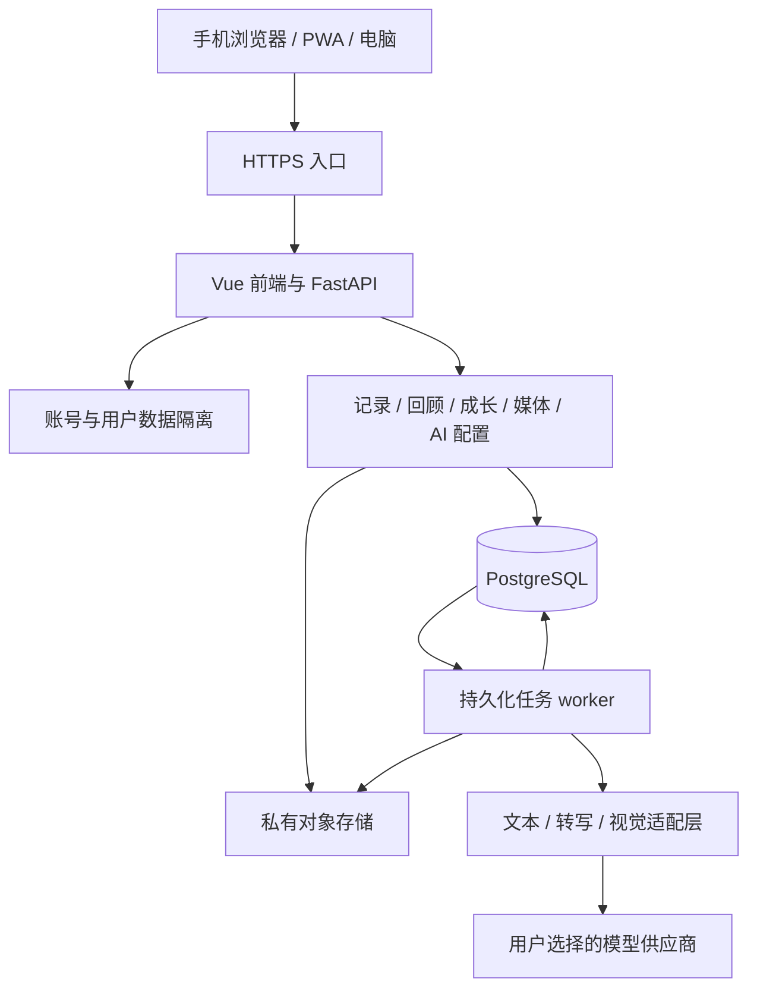

# 游戏人生：产品复盘与下一阶段建议

日期：2026-10-09。依据：本次三轮访谈、项目需求与决策记录、现有代码及已有界面截图。

本文是供讨论和排期的建议稿。用户已确认的意图与下面的设计建议分开记录；本文不代表功能已实现，也不替代现有账目和版本验收记录。

## 本轮补充：节约预算后的收敛建议

用户进一步提出优先节约资金，并询问语音、视频是否必要。结合当前规模，调整近期推荐为：文字为主的邀请制手机内测；语音先使用手机输入法转文字，站内录音、音视频附件及分析暂缓。手机便捷输入仍是重点。

前文 ¥300–1,000/月对应独立托管数据库等较完整配置，不是上云最低费用。近期改为应用与 PostgreSQL 同机、独立备份的小型部署，按 ¥100–200/月预留基础设施预算，域名年费和模型费用单列。备份开支属于估算，最终以地域、套餐、续费和用量核算；该配置需要自己维护，单机故障会影响可用性。

查询时腾讯云产品页列出内地 2核4GB、100GB 系统盘的套餐为 ¥100/月，另有 ¥45/月的 2核2GB 入门套餐。建议优先评估 4GB 内存方案，不根据用户数量直接保证容量。[腾讯云轻量应用服务器](https://cloud.tencent.com/product/lighthouse)

UI 技能已查询：Anthropic 官方仓库的 frontend-design 适合用于布局、字体、配色、视觉方向及响应式设计，作为后续候选；目前仅查阅，未安装，也未开始重做界面。[frontend-design 技能原文](https://github.com/anthropics/skills/blob/main/skills/frontend-design/SKILL.md)

## 1. 已明确的方向

最重要的价值是帮助自己持续做提升自己的事情、获得意义感，并留下可回看的生活记录。先服务本人，再邀请朋友反馈，未来希望公开提供服务、形成面试亮点，并探索收入。

手机随时记录是近期强需求。白天碎片记录，睡前集中回顾；有空可以立即处理 AI 判定，忙时可以稍后补充和确认。用户接受云端保存，希望能下载自己的数据。

用户接受区分成长经验与当前状态。惩罚规则保留，AI 可根据生病等背景酌情处理，并记住相关处境。具体规则和效果仍需试用验证。

每位用户绑定自己的模型 API Key，可选择不同供应商。语音转文字已经有价值，保存原始声音更好；视频记录、分析也有期待。AI 对话助手和桌宠尚未确认必要性。

## 2. 产品定位与主要判断

建议定位：**用轻松的记录与回顾，把生活中的行动、变化和意义积累成可看见的成长。**

核心体验是：随手记录 → 安心保存 → 按需分析 → 睡前回顾 → 看到积累 → 更愿意行动。

从旁观者看，目前的主要问题是功能展开得比真实使用验证更快。现有挑战、押金、金币、商店、成就、豁免可以保留，但新增投入应优先给手机记录和回顾。用户暂时没有明确目标，也应能完整使用系统。

需要调整产品中“科学量化”的承诺：运动有益等行为依据，不等于存在经过验证的“某次跑步准确增加多少体能点”的换算。AI 给出的置信度也不能直接当作经过校准的真实概率。产品应说明事实来源、游戏规则和不确定处，以可解释的成长反馈为主要承诺。

个人版与公众版建议使用同一套代码，通过配置、功能开关、规则版本和独立部署区分。避免长期维护两套相互分叉的业务实现。

## 3. 功能设计

### 3.1 一个统一记录入口

文字、语音、图片、视频和将来的对话记录，都进入同一个记录体系。每条记录保留原始内容、发生时间、来源、附件和处理状态；AI 提炼出的事件、标签、摘要是派生内容，可以修订。

一次日记可能包含多件事，同一件事可能在白天记录和睡前回顾中重复出现。建议显式关联，而不是仅靠 AI 的文字判断去重。已入账事件的补充沿用修订与审计规则，避免再次发放奖励。

原始记录与用户确认后的事件分别保存，不能让 AI 整理覆盖原文。结构中区分：实际行动、计划、主观感受、AI 建议、推测。对话里的“我准备跑步”不能按“已经跑步”入账。

### 3.2 保存与分析分离

记录保存状态与 AI 处理状态独立。推荐默认先保存成功，再提供“现在分析”和“留到今晚”。不要求每条记录都分析，也不把所有人的记录默认上传给模型。

AI 处理可以经历：未请求、排队、分析中、待补充、待确认、已入账、失败。用户离开页面或关闭手机，已提交的后台任务仍然可以继续；再次打开时能看到结果和失败重试入口。

提交使用幂等标识，避免弱网重试导致重复记录；入账也有独立幂等保护。任务可能重试，最终业务效果仍只能发生一次。

### 3.3 睡前回顾

自动汇总当天已有记录，展示尚未回答的问题和待确认结果。用户可以补充遗漏、修正事实，或一句“今天就这些”结束。

回顾不重新奖励已经处理过的同一件事。不强制填满所有生活面，不把“没有记录”推断为“没有行动”。当日总结突出一件值得记住的事、一项真实积累和一个可选的小行动。

### 3.4 成长经验与当前状态

| 内容 | 表达什么 | 推荐依据 |
|---|---|---|
| 成长经验 | 已完成行动留下的积累 | 经确认的行动、投入及规则 |
| 能力表现 | 当前可观察的表现 | 跑步成绩、作品、实际练习成果等 |
| 主观状态 | 当下感受与处境 | 用户自述、简短自评、带时间的观察 |
| 游戏经济 | 奖励与挑战约定 | 明确的金币和挑战规则 |

历史成长经验原则上不因状态低落被抹去；纠错、重复或撤销仍可回滚。约定的惩罚可作用于挑战、金币或明确标识的游戏状态。生病造成的暂时状态变化，不应解释为努力消失。

幸福感、意义感首先来自用户表达，不能仅因完成任务就自动推断上涨。主观状态允许未知和过期；不必为每个人生成一整套貌似精确的分数。

现有 13 维保留为历史体系并标注旧规则。新体系用新版本逐步开始，先迁移副本并核验余额与流水，不直接重算全部历史或把旧分数改名当成新指标。

### 3.5 有边界的酌情处理

AI 可以结合上下文提出减免建议，但程序负责检查规则范围和实际结算。结果说明基础规则、背景事实、调整理由和最终变化。

记忆区分长期偏好与有时效的情况。例如“用户偏好温和提醒”可以长期保留；“本周生病”应有时间范围，并在适当时机询问是否恢复。用户可以查看、更正、删除记忆。

事实记录、状态判断、规则调整分别展示。一般纠正允许稍后完成，涉及扣账时保留确认与复核入口。已入账结果通过补偿流水更正，不覆盖历史流水。

### 3.6 媒体与助手的顺序

1. 先让手机输入法语音转文字可顺畅提交。
2. 再支持站内录音、保存原音、转写可编辑，关联同一条记录。
3. 加入图片与短视频附件、播放和下载。
4. 根据真实需求加入按需视频摘要：音轨转写、关键帧分析，标明未覆盖的内容。
5. 试做围绕记录的 AI 对话；对话结束生成可编辑的记录草稿，由用户确认。
6. 最后用小型桌宠承载已有提醒，先验证提醒是否有帮助，再投入复杂动画。

视频保存与视频分析分别实现、分别计费。关键帧不能代表视频全部细节；当前文字模型调用层也不能直接视为已经支持音视频。

## 4. 推荐架构及现有差距

推荐：移动端优先 Vue Web/PWA + FastAPI 模块化单体 + PostgreSQL + 私有对象存储 + 持久化任务 worker + 按用户配置的 AI 适配层。

先保持一个代码库和有限的部署进程。任务队列可以先用 PostgreSQL 任务表，具备租约、重试、超时、用户归属和幂等机制；有吞吐需求后再引入独立队列。AI 调用期间不长期持有数据库写锁，回写时检查记录版本和归属。

推荐的运行配置是小型应用实例、独立托管 PostgreSQL、对象存储及异地备份。为降低初期账单，也可同机部署 PostgreSQL，但需要自己承担更新、备份和恢复。

### 代码已具备的基础

- Vue、FastAPI 和服务层可继续沿用，不需要为了公开使用重写全部应用。
- 大部分业务表已有 user_id；模型配置按用户与用途解析，有扩展基础。
- 现有流水、审计、幂等与事务保护是重要资产，应保留并在新数据库重新验收。

### 上云前的具体改动

| 现状证据 | 建议 |
|---|---|
| app/services/user_service.py 固定获取 default 用户，多条路由依赖它 | 建立注册/邀请、登录会话和统一 current_user；所有查询与写操作核对归属 |
| 已有 user_id，但请求不区分真实登录用户 | 覆盖按 ID 获取、修改、删除、导出、附件和任务等全部路径，验证用户 A 无法操作用户 B 数据 |
| app/services/llm_config.py 从 Setting.value 读取 api_key；保存逻辑直接写入该值 | 云端改为加密存储或凭据库，密钥与数据库分开管理；保留掩码回显，清理异常与日志中的敏感内容 |
| 模型 base_url 可配置 | 公开部署时限制协议、端点与出站目的地，阻止访问服务器内网及云元数据地址 |
| app/database.py 使用启动时补列、回填 | 用有版本的 Alembic 迁移；SQLite 到 PostgreSQL 迁移需验证类型、约束、序列和事务行为 |
| app/services/llm_service.py 以同步文字请求为主 | 逐步引入后台任务、供应商超时与有限重试；文字、语音、视觉分别声明能力 |
| app/main.py 采用开发用宽松跨域配置 | 同域 HTTPS 部署，收紧跨域与生产配置；增加请求限流、备份恢复和基本监控 |

建议保持原有本地库作为迁移前副本，先在独立环境跑迁移与双用户验收。数据库可配置连接串不代表业务已经完成 PostgreSQL 兼容。

Alembic 提供 SQLAlchemy 数据库的版本迁移机制，适合替代仅自动补列的生产迁移方式。[Alembic 官方教程](https://alembic.sqlalchemy.org/en/latest/tutorial.html)

PWA 可从链接直接使用，并在支持的平台添加到主屏幕；安装表现因平台而异。它适合作为近期手机入口。[MDN：PWA 安装](https://developer.mozilla.org/en-US/docs/Web/Progressive_web_apps/Guides/Making_PWAs_installable)

站内麦克风录音需要安全上下文与用户授权，正式部署应使用 HTTPS，并验证实际安卓、iPhone 浏览器的录音、锁屏、中断和格式表现。[MDN：getUserMedia](https://developer.mozilla.org/en-US/docs/Web/API/MediaDevices/getUserMedia)

### 部署地域

长期主要服务中国内地用户，优先考虑内地地域与同地域数据服务；备案准备可以与开发并行。为尽早开展小范围私测，可以评估香港地域，先用你和朋友的实际移动网络测试速度，再确定。应用、数据库和对象存储尽量靠近，减少跨地域延迟和传输。

内地服务器对外提供网站服务涉及 ICP 备案；香港等非内地地域的 ICP 要求不同。这仅说明选址影响，不代表其他上线要求自动消失。[阿里云：ICP备案流程概述](https://help.aliyun.com/zh/icp-filing/basic-icp-service/user-guide/icp-filing-application-overview)

### BYOK 与费用归属

保留每用户自己的文本模型配置，提供已验证供应商预设及连通测试。免费模型可作为用户选择，不能把免费额度作为长期稳定承诺。换模型记录模型、提示词和规则版本，既有记录不自动重判。

文字 Key 不一定能用于语音或视觉。初期转写可以由平台统一提供有限额度，设置清楚归属和上限；高级用户再自行配置。平台密钥回退必须经过明确授权和配额判断，不能把本地 .env 兜底原样变成无限共享额度。

附件默认私有，上传和访问均校验用户归属；临时签名 URL 不能替代权限检查。用户应能导出文字、结构化数据及附件，删除媒体时处理缩略图等派生文件，并说明备份保留期限。不同用户的离线缓存、任务和记忆都需隔离；登出清理账户缓存。

## 5. UI：温暖手账与轻量角色成长

现有截图以长表单、多个白色卡片、九个并列导航入口为主。功能可以找到，但手机上容易需要大量滚动；属性面板的信息密度较高，当前状态与初始解释也容易混在一起。

建议手机底部四个入口：**今天、手账、成长、我的**，配一个始终容易触达的“记一下”按钮。录入采用底部抽屉，文字与录音优先，完整参数逐步展开。

| 页面 | 首屏重点 | 收入二级页面的内容 |
|---|---|---|
| 今天 | 记录入口、今日片段、待处理数量、睡前回顾 | 完整打卡管理、目标编辑 |
| 手账 | 按时间回看文字与媒体、搜索 | 标签筛选、完整 AI 分析 |
| 成长 | 成长积累、近期状态、里程碑 | 全部属性、挑战、商店、成就 |
| 我的 | 角色、模型、数据与隐私 | 锚点库、规则解释、账号设置 |

判定中心作为“待处理”工作台从今天进入，也能从具体记录打开。用户默认看到简短结果，展开才显示依据、补充、复核与审计。纯享记录并入统一手账，用标签或筛选区分。

视觉建议采用温暖浅底、清晰文字、统一间距与少量强调色；保留你偏好的浅色方向。角色、里程碑与微动画承载趣味，表单和按钮保持清楚。图表聚焦近期变化，完整 13 维雷达图放到详情。

颜色不要单独承担涨跌语义，始终配合加减号、文字与图形。当前“增长为红色”与危险按钮同色的情况应通过独立语义变量调整。

桌面端采用侧栏与更宽的内容区，保持同一套导航逻辑。最终视觉需要用真实手机截图和实际输入流程验证，现有桌面截图不能证明手机体验。

## 6. 成本方案

下面保留最初的三档规划供比较；按本轮节约预算的要求，**近期优先选择 A 的文字内测配置，按 ¥100–200/月预留，实际用量决定扩容；B 是后续减少运维负担的选项。**三档均为规划预留，非厂商报价；原假设约 5–20 位试用者，以文字和短语音为主，少量附件，无高频长视频分析。近期暂缓站内音视频，人数本身不代表容量保证。

| 档位 | 每月基础设施预算预留 | 组成与取舍 |
|---|---|---|
| A：节省内测 | ¥100–300 | 单台云主机，应用与 PostgreSQL 同机，私有对象存储、独立备份；运维由自己承担 |
| B：后续独立托管配置 | ¥300–1,000 | 应用实例、独立托管 PostgreSQL、对象存储、备份和基础监控；数据维护与故障定位更清晰 |
| C：扩展准备 | ¥1,000–3,000+ | 根据实际需要增加实例、数据库资源、媒体容量、分发与监控；使用规模上来后再评估 |

以上不含用户自付的模型费、平台补贴的语音/视觉费、短信、大量媒体出网和人工。域名年费单列；购买时比较首年与续费价格。具体机器、数据库地域、促销和带宽选定后才能生成采购清单。

### 文本模型示例

按查询时 DeepSeek 官方表，deepseek-flash 高峰、缓存未命中的输入价为 $0.30/百万 token，输出价为 $1.20/百万 token。假设每人每天 10 次实际模型调用，每次输入 8,000、输出 1,000 token，30 天约为 $1.08。这里只是该模型、该用量的算例；输入包含历史背景，输出应包含供应商计费的全部 token。追问、记忆、报告、重试、多次抽取会增加调用量，不能把一次用户提交固定当作一次调用。[DeepSeek 官方定价](https://api-docs.deepseek.com/quick_start/pricing/)

模型名称及价格应按当前官方支持列表核实，不能继续仅凭项目早期默认名推断可用性。是否适合判定，应通过相同样本下的结构正确率、结果稳定性与解释质量评估，不能仅看价格。

### 语音与媒体示例

按查询时百炼官方表，华北2（北京）paraformer-v2 录音文件识别为 ¥0.00008/秒。每天 10 分钟、30 天共 18,000 秒，不扣免费额度的识别费约 ¥1.44/人/月；不含存储、传输及后续文本分析。其他模型、地域、实时识别的价格不同，最终选型先验证中文、口音、噪声和长录音效果。[百炼官方定价](https://help.aliyun.com/zh/model-studio/model-pricing)

媒体成本需要同时算容量、请求和流出流量，不能只看每 GB 存储费。OSS 官方说明公网下载、预览也会产生出网费用。[OSS 计费概述](https://help.aliyun.com/zh/oss/billing-overview)

给每用户设置附件容量、单文件大小、转写时长和 AI 调用额度。实际预算采用：基础设施 + 平台承担的模型/转写/视觉 + 媒体存储与传输 + 其他服务。先记录用量，再优化；预算告警并不等于自动停止所有计费。

## 7. 下一阶段路线与完成标准

不在投入时间未明确时承诺几周上线，按可验收成果推进。

| 顺序 | 交付目标 | 完成标准 |
|---|---|---|
| 第一阶段 | 邀请制手机内测 | 关掉自己的电脑仍可访问；独立登录；跨账号不能读写；各自配置模型；手机保存、回看、导出；备份可恢复 |
| 第二阶段 | 轻松记录和睡前回顾 | 保存不依赖 AI 成功；可稍后处理与回答；弱网不重复；当天汇总不重复奖励；站内录音及原音回放 |
| 第三阶段 | 成长表达与视觉统一 | 新旧规则区分；经验与状态分开；手机四入口；状态有时间和来源；历史账目可对账 |
| 第四阶段 | 媒体与有限助手试验 | 图片、短视频附件；按需分析；对话生成草稿；轻量提醒可关闭；效果由使用反馈验证 |
| 第五阶段 | 公开测试与收费验证 | 能说清留存理由、运行成本与付费价值，再接支付、套餐和公开推广 |

第一阶段建议邀请 5–10 位朋友，至少观察两周真实使用。记录首次成功率、记录耗时、AI 等待与失败、重复提交、七日回访、睡前回顾使用情况。通过自愿反馈了解记录是否有帮助，不能仅靠记录数判断意义感，也不应默认读取朋友的私密内容作为测试素材。

先看哪里让人放弃，再决定新增功能。若朋友卡在填 API Key，后续可测试少量平台体验额度；若卡在确认步骤，则优化处理流程；若回看没有价值，则优先改善手账和总结。

## 8. 商业化与面试展示

商业化建议先验证用户是否愿意持续使用和保存记录，再测试付费意愿。可探索的付费价值包括更多媒体容量、更长的转写额度、深度回顾、年度纪念册和个性化外观。核心导出与数据可携带能力应保留。

BYOK 适合早期技术型朋友，但面向公众需要验证配置门槛；技术用户自带 Key 与普通用户购买平台额度可以是同一产品的两种模式。现有金币和商店继续定位为游戏内自我奖励机制，支付套餐另行设计。

对面试，重点呈现真实工程问题和可复现证据：双用户权限隔离、AI 异步任务与幂等结算、媒体处理、版本化判定、账目恢复、供应商成本观测，以及一次由真实反馈推动的体验改进。准备演示账号、无隐私样例、架构图、测试与故障恢复记录。

最有价值的项目叙述是：发现自己无法及时记录 → 设计手机与异步流程 → 真实用户试用 → 根据证据迭代。功能数量和堆叠技术名词不足以替代这条证据链。

## 9. 仍需验证的事项

- 实际手机系统、常用浏览器，以及录音中断和弱网表现。
- API Key 配置对朋友的阻力、是否需要有限试用额度。
- 扣分、押金与提醒是否推动行动，是否使人减少真实记录。
- AI 对话与桌宠是否有持续价值。
- 视频主要用于纪念、提取内容还是分析动作；不同场景需要不同实现。
- 最终地域、预算、规则细节和商业套餐仍待选择；本文不把建议写成已获确认的需求。
